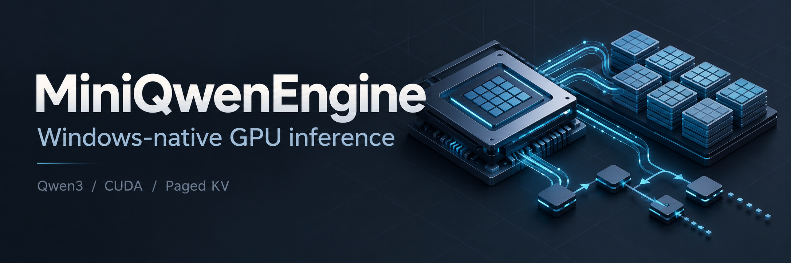

<p align="center"></p>

<p align="center"><a href="README.md">简体中文</a> · <strong>English</strong></p>

# MiniQwenEngine

A lightweight single GPU inference engine for Windows 11, with local Qwen3-0.6B chat and HTTP/SSE serving. The project implements the model forward pass, Paged KV Cache, continuous batching, and CUDA kernels. Transformers loads weights and the tokenizer and provides a correctness reference.

## Features

- **Native Qwen3**: Q/K RMSNorm, RoPE, GQA, and SwiGLU, with incremental generation and batch decode.
- **Paged KV Cache**: paged reads and writes, reference counting, LRU eviction, and Prefix Cache sharing of complete blocks that skips cached computation.
- **Continuous batching**: decode-first scheduling, token budgets, chunked/ragged prefill, request cancellation, and cleanup on errors.
- **CUDA execution**: custom PagedAttention, paged prefill, Norm, Residual, SwiGLU, Embedding, RoPE, KV scatter, and greedy sampling. Linear uses cuBLAS/cuBLASLt, with fused QKV and Gate/Up projections.
- **CUDA Graph**: single-token decode for individual requests and batches, with logits and greedy sampling optionally captured in the graph.
- **Optional operator library**: `dandan_ops` integration for FP16 Linear, D128 GQA dense Flash prefill, and W4A16 computation.
- **Inference interfaces**: CLI, multi-turn chat, HTTP/SSE, and single-request greedy prompt-lookup speculative decoding.

## Quickstart

The commands below use PowerShell. If you already have the project, enter its root directory and load `enter_project.ps1` instead of cloning it. Skip virtual environment creation or model download if they are already available. Prepare the runtime requirements listed below before compiling the CUDA extension.

### Installation

```powershell
git clone https://github.com/dandan20031031/myvllm-mini-engine.git D:\myvllm-mini-engine
Set-Location -LiteralPath 'D:\myvllm-mini-engine'
. .\scripts\enter_project.ps1

python -m venv .venv
.\.venv\Scripts\python -m pip install torch==2.9.1 --index-url https://download.pytorch.org/whl/cu128
.\.venv\Scripts\python -m pip install -e ".[model,cuda]" "transformers==4.57.6"
```

The environment script keeps pip, Hugging Face, Torch, and CUDA build caches and temporary directories inside the project. In each new PowerShell session, enter the project root and run `. .\scripts\enter_project.ps1` first.

### Download the model

```powershell
.\.venv\Scripts\python -c "from huggingface_hub import snapshot_download; snapshot_download('Qwen/Qwen3-0.6B', local_dir='models/Qwen3-0.6B')"
```

You can also use an existing complete model directory containing the config, tokenizer, and safetensors weights. Adjust `--model` when starting the engine.

### Local chat

```powershell
.\.venv\Scripts\python -m mini_engine `
  --model .\models\Qwen3-0.6B --chat `
  --device cuda --dtype bf16 `
  --prefill-backend cuda --decode-backend cuda `
  --elementwise-backend cuda --data-backend cuda --linear-backend cuda `
  --sampling-backend cuda --fuse-projections --cuda-graph `
  --max-new-tokens 128 --local-files-only
```

Use `/clear` to reset the conversation and `/exit` to quit. For a single generation, replace `--chat` with `--prompt "Explain KV Cache"`. Remove `--cuda-graph` for eager execution. The first run compiles the CUDA extension and captures the required graphs, so it takes longer than subsequent requests.

### HTTP / SSE server

```powershell
.\.venv\Scripts\python -m mini_engine.server `
  --model .\models\Qwen3-0.6B --served-model-name qwen3-0.6b `
  --device cuda --dtype bf16 --prefill-backend cuda --decode-backend cuda `
  --elementwise-backend cuda --data-backend cuda --linear-backend cuda `
  --sampling-backend cuda --fuse-projections --cuda-graph `
  --prefill-chunk-size 128 --local-files-only
```

Send a request from another PowerShell session:

```powershell
$body = @{model='qwen3-0.6b'; messages=@(@{role='user'; content='Explain KV Cache'}); max_tokens=64; temperature=0} | ConvertTo-Json -Depth 5
Invoke-RestMethod http://127.0.0.1:8000/v1/chat/completions -Method Post -ContentType 'application/json; charset=utf-8' -Body ([System.Text.Encoding]::UTF8.GetBytes($body))
```

The base URL is `http://127.0.0.1:8000/v1`. Supported endpoints are `/health`, `/v1/models`, and `/v1/chat/completions`; set `stream: true` to use SSE. The server implements a greedy chat subset with usage reporting and requires `temperature: 0`. Tools and multimodal inputs are unsupported. The default Graph server context limit is 1024 tokens, including the input and output budget.

## Entry points and scripts

| Entry point | Purpose |
|---|---|
| `python -m mini_engine` | Single-request generation and interactive multi-turn chat |
| `python -m mini_engine.server` | HTTP/SSE serving through a single GPU worker |
| `benchmarks/benchmark_chat_graph.py` | Alternate single-request eager/Graph runs on the same model; record first calls, TTFT, TPOT, and actual output throughput |
| `benchmarks/benchmark_native_batch.py` | Measure batch eager/Graph execution through the actual scheduler/runtime |
| `benchmarks/benchmark_paged_sweep.py` | Compare original and vectorized PagedAttention kernels across block sizes |
| `benchmarks/compare_paged_backends.py` | Compare this project's CUDA and Mini Triton components with identical inputs in separate environments |
| `benchmarks/profile_native_batch.py` | Collect CPU/GPU timelines, NVTX ranges, and Chrome traces to locate bottlenecks |

See the [benchmark guide](benchmarks/README.md) for more correctness checks, prefill ablations, and serving load tests.

## Benchmarks

These are recorded experimental results. Full conditions and source evidence are in the [validation and benchmark report](reports/VALIDATION_AND_BENCHMARKS.md).

### Qwen3-0.6B single-request generation

RTX 5080, FP16, built-in CUDA backends and cuBLAS Linear, fused projections, CUDA greedy sampling, and decode Graph. Two prompts, each tested with 64/128 output tokens, with six measured repetitions per case after warmup.

| Metric | Recorded result |
|---|---:|
| TTFT P50 | 19.75–24.40 ms |
| TPOT P50 | 2.53–2.66 ms/token |
| Aggregate output throughput | 342.11–357.51 tokens/s |

Timing runs from prefill to the last output token, excluding model loading, tokenization, text decoding, and initial Graph capture. Throughput is the total number of actual output tokens divided by total request latency. These are local single-request generation results; HTTP and multiple-request throughput require separate measurements.

```powershell
# Paired single-request eager / Graph measurements
.\.venv\Scripts\python benchmarks\benchmark_chat_graph.py --model .\models\Qwen3-0.6B --dtype fp16 --ignore-eos

# Continuous batching; the script runs both eager and Graph modes
.\.venv\Scripts\python benchmarks\benchmark_native_batch.py --model .\models\Qwen3-0.6B --dtype bf16 --fuse-projections --local-files-only --ignore-eos
```

### PagedAttention component comparison

Measured locally on an RTX 5080 on 2026-10-26: FP16, Hq=16, Hkv=8, head_dim=128, block_size=256, with random noncontiguous physical pages. Both implementations used identical input bytes and passed checks against an FP32 oracle. The table shows the range of per-call Graph timing P50 values from two independent process runs, in µs.

| Batch / Context | This project's CUDA | MiniVLLM Triton |
|---|---:|---:|
| 1 / 128 | 18.945–19.330 | 3.917–4.323 |
| 8 / 512 | 40.340–40.422 | 14.308–14.834 |
| 32 / 2048 | 396.343–396.744 | 361.462–366.140 |

This project used PyTorch 2.9.1+cu128; Mini used 2.11.0+cu128, Triton 3.8.0, and a pinned version with Windows fixes. The software stacks differ, GPU clocks were not locked, and the ranges are not confidence intervals. These results cover only PagedAttention. Full model execution also includes GEMM, prefill, sampling, and scheduling. Nano-vLLM has not completed local GPU validation, and no comparison of all three engines under matching conditions is available. [Comparison data and reproduction](reports/VALIDATION_AND_BENCHMARKS.md)

## Project structure

```text
myvllm-mini-engine/
├── mini_engine/
│   ├── model/          Native Qwen3, model loading, and runner
│   ├── cache/          KV pool, physical pages, and Prefix Cache
│   ├── engine/         Requests, scheduling, ragged batches, runtime, and CUDA Graph
│   ├── kernels/        CUDA sources, backend dispatch, and numerical references
│   ├── quantization/   Quantization references and dandan W4A16 bridge
│   ├── serving/        HTTP protocol, GPU worker, and SSE
│   ├── config.py       Model and backend configuration
│   └── cli.py          Shared CLI / HTTP startup arguments
├── benchmarks/         Performance measurements, correctness checks, and profiling
├── scripts/            Windows environment scripts
├── tests/              Model, kernel, scheduling, and serving regression tests
└── reports/            Architecture and experiments; measurement summaries in data/
```

Python integration uses `mini_engine.model.NativeQwen3Runner` and `mini_engine.RunnerConfig`. Create batch sessions with `runner.create_batch_runtime()`. See the [architecture report](reports/ARCHITECTURE.md) for the call flow and resource lifecycle. Models, virtual environments, caches, and build artifacts are ignored by Git.

## Requirements and supported scope

- **Validated environment**: Windows 11, RTX 5080, Python 3.13, PyTorch 2.9.1+cu128, Transformers 4.57.6, MSVC C++ Build Tools, and Ninja. A working CUDA Toolkit and compiler must be configured.
- **CUDA versions**: the engine extension passed tests on the target machine with Toolkit 13.3. The standalone operator library was previously built with 12.8. Other PyTorch / Toolkit / GPU combinations require validation.
- **Floating point and quantization**: FP32/FP16/BF16 execution paths are supported; custom CUDA attention and related kernels require FP16/BF16. INT8/INT4/FP8 E4M3 and E5M2 have references that dequantize before computing. High-performance FP8 GEMM/KV, NVFP4, and MXFP8 are not implemented.
- **Optional dandan backends**: install the operator library separately, then use `--dtype fp16 --linear-backend dandan_cuda`. Use `--prefill-backend dandan` for dense Flash; add `--quantization int4 --quant-backend dandan` for W4A16, with group size 64/128. Quality and speed require validation for each configuration.
- **Current limits**: single GPU, Qwen3-0.6B, and greedy serving. CUDA prefill reads paged history directly; other prefill backends still run dense attention per request. FP16 ragged execution has not passed strict elementwise KV checks. Matching short outputs does not establish batch invariance.
- **Graph and speculation**: Graph covers single-token decode; prefill and CPU scheduling remain outside the graph. For single-request prompt lookup, use `--speculative prompt_lookup --max-draft-tokens 4` and remove `--cuda-graph`. Batch speculation is not supported yet.

Install development dependencies to run regression tests and full model validation:

```powershell
.\.venv\Scripts\python -m pip install -e ".[dev]"
$env:MINI_ENGINE_TEST_CUDA = '1'
.\.venv\Scripts\python -m pytest -q
.\.venv\Scripts\python benchmarks\validate_system_extensions.py --dtype bf16 --http-smoke
```

Full model validation requires local weights and a GPU. The pytest cache is stored in `build/pytest_cache`. See the [validation report](reports/VALIDATION_AND_BENCHMARKS.md) for the scope of historical checks.

## References and license

The project's inference mechanisms and organization draw on [vLLM](https://github.com/vllm-project/vllm), [Nano-vLLM](https://github.com/GeeeekExplorer/nano-vllm), and [MiniVLLM](https://github.com/Wenyueh/MinivLLM). The code is licensed under [Apache-2.0](LICENSE). Qwen3 weights and tokenizer follow their own license terms.
